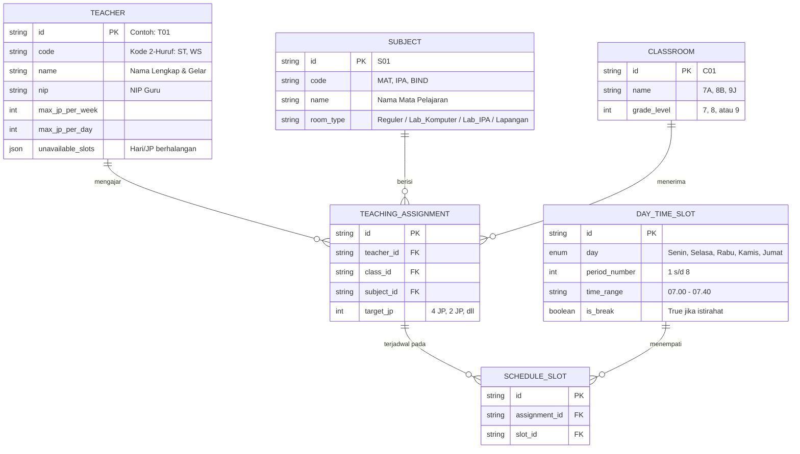

# limarTime - Sistem Informasi Penjadwalan Sekolah
## Blueprint & Spesifikasi Lengkap Sistem (*Master Blueprint*)

Dokumen ini merupakan integrasi menyeluruh dari rencana perancangan, arsitektur teknis, spesifikasi algoritma, pemodelan data, serta rencana implementasi aplikasi **limarTime** yang disesuaikan khusus untuk karakteristik **SMP Negeri 1 Ngawi** (30 Rombel, 55 Guru, dan struktur jam belajar variatif).

---

## 1. Profil Platform & Arsitektur Sistem

* **Jenis Aplikasi**: Web Application Modern (Next.js / React) dengan dual-access role:
  * **Admin / Tim Kurikulum (Protected Access - Wajib Login)**:
    * Autentikasi aman berbasis **Username & Password**.
    * Akses penuh ke: Dashboard Admin, Manajemen Data Master & Bell Schedule, Auto-Generate Engine, Interactive Drag-and-Drop Matrix, dan Cetak PDF/Excel.
  * **Publik / Siswa, Wali Murid & Guru (Public Access - Tanpa Login)**:
    * Akses langsung ke portal jadwal sekolah (*Mobile Public Viewer*).
    * Pencarian instan jadwal harian & mingguan per kelas (7A–9J) atau per nama guru tanpa memerlukan akun atau kata sandi.
* **Pendekatan Penjadwalan**: **Semi-Otomatis (Hybrid Intelligent Scheduling)**:
  1. **Langkah 1 (Auto-Solve)**: Algoritma cerdas menyusun draf jadwal otomatis berbasis *Constraint Satisfaction Problem* (menjamin 0 bentrok / zero hard-conflict).
  2. **Langkah 2 (Fine-Tuning Manual)**: Operator kurikulum dapat menggeser/menukar jadwal secara manual via **Drag & Drop Timetable Matrix** dengan validasi bentrok instan secara visual.

### Tech Stack Rekomendasi
* **Frontend**: React / Next.js, Vanilla CSS / Tailwind CSS, Modern UI dengan visual feedback real-time, Drag-and-Drop scheduling grid.
* **Backend & Processing**: Node.js / TypeScript (Web Worker / Background Processing) atau FastAPI (Python) terintegrasi solver CP-SAT (`Google OR-Tools`).
* **Penyimpanan Data**: PostgreSQL / SQLite / JSON Store terstruktur untuk relasi Guru, Mapel, Rombel, dan Slot Waktu.
* **Pencetakan & Dokumen**: Generator PDF & XLSX siap cetak otomatis (A4/F4 portrait & landscape).

---

## 2. Parameter Sekolah & Struktur Waktu

### A. Parameter Sekolah (SMP Negeri 1 Ngawi)
* **30 Rombongan Belajar (Rombel)**:
  * Jenjang Kelas 7 (10 Kelas): `7A, 7B, 7C, 7D, 7E, 7F, 7G, 7H, 7I, 7J`
  * Jenjang Kelas 8 (10 Kelas): `8A, 8B, 8C, 8D, 8E, 8F, 8G, 8H, 8I, 8J`
  * Jenjang Kelas 9 (10 Kelas): `9A, 9B, 9C, 9D, 9E, 9F, 9G, 9H, 9I, 9J`
* **55 Tenaga Pendidik**:
  * Menggunakan kode resmi 2-huruf unik (misal: `ST, WS, AB, RT, TO, RY, FJ, dll.`).
  * Setiap guru memiliki beban jam mengajar mingguan dan batas harian tertentu.

### B. Struktur Hari Fleksibel & Durasi Jam Pelajaran (JP) Dinamis
Sekolah menerapkan sistem jam pelajaran yang dapat dikustomisasi secara fleksibel:
* **Durasi Standar per JP**: **40 Menit** (kondisi operasional normal).
* **Durasi Khusus per JP**: **30 Menit** (dapat diaktifkan untuk hari tertentu seperti **Jumat**, atau mode khusus seperti **Bulan Ramadhan**, **Pekan Penilaian/Ujian**, atau **Agenda Khusus Sekolah**).
* **Fitur Custom Time Bell Schedule**: Operator dapat mengedit jam mulai, jam selesai, durasi per JP (misal: 40 menit vs 30 menit), serta menyisipkan jeda istirahat/pembiasaan untuk setiap hari secara independen.

Tabel acuan alokasi JP dan agenda harian:

| Hari | Durasi Standar JP | Jumlah JP | Rentang Waktu Estimasi | Agenda Tambahan / Catatan |
| :--- | :--- | :--- | :--- | :--- |
| **Senin** | 40 Menit | 6 JP | 08.00 – 14.20 | Upacara Bendera pagi, Kokurikuler Mengaji, Istirahat/Sholat/MBG |
| **Selasa** | 40 Menit | 7 JP | 07.00 – 14.00 | Pembiasaan pagi, Kokurikuler |
| **Rabu** | 40 Menit | 7 JP | 07.00 – 14.00 | Pembiasaan pagi, Kokurikuler |
| **Kamis** | 40 Menit | 8 JP | 07.00 – 14.30 | Pembiasaan pagi, Kokurikuler |
| **Jumat** | **30 Menit** *(Mode Khusus)* / 40 Menit | 4 JP | 07.50 – 11.00 | Adiwiyata / Senam pagi, MBG, Siang: Pramuka / Ekstrakurikuler |

---

## 3. Aturan & Batasan Penjadwalan (*Constraints Engine*)

Masalah penjadwalan diselesaikan sebagai *Constraint Satisfaction Problem (CSP)* dengan aturan:

### A. Hard Constraints (Wajib Dipenuhi 100% / Toleransi 0 Bentrok)
1. **No Teacher Conflict**: Seorang guru dilarang mengajar di lebih dari satu kelas pada hari dan jam pelajaran yang sama.
2. **No Classroom Conflict**: Suatu kelas dilarang menerima lebih dari satu mata pelajaran/guru pada jam pelajaran yang sama.
3. **Teacher Availability (Off-Days / Izin)**: Guru yang memiliki jadwal berhalangan tetap (izin tugas luar, studi, atau hari bebas mengajar) tidak boleh dijadwalkan pada slot tersebut.
4. **Room Capacity & Special Facilities**: Penggunaan ruang khusus (Laboratorium Komputer/Informatika, Laboratorium IPA, Lapangan Olahraga/PJOK) tidak boleh melebihi jumlah unit ruang fisik yang ada.
5. **Kesesuaian Total Target JP**: Akumulasi JP per mapel di tiap rombel harus tepat sesuai kurikulum (misal: Matematika 4 JP/minggu, PAI 3 JP/minggu, dsb.).

### B. Pola Blok Jam & Pemecahan Sesi (*Session Splitting*)
1. **Mapel Beban 4 JP/minggu (Matematika, B. Indonesia, B. Inggris, dll.)**:
   * Wajib dipecah menjadi **2 pertemuan di hari berbeda** dengan pola **2 + 2 JP**.
   * Dilarang dijadwalkan 4 JP penuh dalam satu hari untuk mencegah kejenuhan belajar.
2. **Mapel Beban 2 JP/minggu**:
   * Dijadwalkan dalam **1 pertemuan blok 2 JP berturut-turut ($1 \times 2$ JP)**, bukan 1 JP terpisah di hari berbeda.
3. **Mapel Beban 3 JP/minggu**:
   * Dijadwalkan sebagai blok kontinu 3 JP berturut-turut pada hari yang sama.
4. **Blok Kontinu Tak Terputus**: Jam pelajaran dalam satu sesi pertemuan harus berurutan (misal JP 1–2, JP 3–4) dan tidak boleh terpotong istirahat panjang.

### C. Soft Constraints (Optimasi Kenyamanan Guru & Kualitas Belajar Siswa)
1. **Jeda Hari Mapel 4 JP**: Pertemuan pertama dan kedua diberi jarak hari (misal: Senin & Kamis, atau Selasa & Jumat; hindari hari berurutan seperti Senin & Selasa).
2. **Maksimal Beban Harian Guru**: Guru dibatasi maksimal 4–5 JP per hari agar tidak kelelahan fisik dan mental.
3. **Penyebaran Beban Mingguan Guru**: Jam mengajar terdistribusi merata sepanjang pekan (menghindari penumpukan jam di awal pekan dan kosong di akhir pekan).
4. **Minimalisasi Jam Kosong (*Gap Hours*)**: Mengurangi jeda jam mengajar guru yang terlalu lama menganggur di sekolah di antara jam masuknya.
5. **Prioritas Jam Pagi Mapel Eksakta/Analitis**: Mata pelajaran berkonsentrasi tinggi (Matematika, IPA) diprioritaskan pada jam pagi (JP 1–4).

---

## 4. Mesin Solver & Pilihan Algoritma (*Scheduling Engine*)

| Algoritma | Cara Kerja | Keunggulan | Kesimpulan Penerapan |
| :--- | :--- | :--- | :--- |
| **Constraint Programming (CP-SAT / OR-Tools)** | Solver berbasis relasi matematika & klausul logika boolean/integer. | Sangat cepat membuktikan solusi optimal tanpa bentrok (*zero conflict*). | ⭐ **Pilihan Utama (Engine Inti)** |
| **Genetic Algorithm (GA)** | Iterasi populasi jadwal acak dengan evaluasi fitness, seleksi, crossover, dan mutasi. | Fleksibel memetakan bobot penilaian soft-constraints yang dinamis. | Alternatif engine berbasis full client/TypeScript. |
| **Greedy Heuristic + Backtracking** | Menempatkan slot tersulit lebih dahulu (*most constrained first*), mundur jika buntu. | Cepat untuk estimasi awal. | Sangat baik sebagai inisialisasi awal (*draft seed*). |

---

## 5. Pemodelan Data (*Data Model*)

---

## 6. Modul & Fitur Utama Aplikasi

### Modul 0: Autentikasi & Keamanan Akses Admin (*Authentication & RBAC*)
* **Halaman Login Admin**:
  * Form input **Username & Password** dengan validasi kredensial aman.
  * Fitur *Show/Hide Password*, proteksi *Brute-Force rate limiting*, dan pesan validasi intuitif.
  * Pengelolaan sesi login admin (Cookie/JWT Session token).
* **Proteksi Akses (Route Guard / Middleware)**:
  * Rute dashboard admin (`/admin/*`), manajemen data master, generator, dan timetable editor otomatis dialihkan ke halaman login jika belum terautentikasi.
  * Fitur **Logout Cepat** dan status bar admin yang menampilkan identitas pengguna aktif.
* **Akses Publik Bebas Hambatan (`/` atau `/jadwal`)**:
  * Pengunjung umum (siswa, orang tua, guru umum) langsung disajikan tampilan jadwal publik tanpa diarahkan ke layar login.

### Modul 1: Manajemen Data Master & Konfigurasi Jam Belajar (*Bell Schedule*)
* **Editor Jam Pelajaran Fleksibel**:
  * Pengaturan jam masuk sekolah, durasi per JP (default **40 menit**).
  * Pengaturan durasi khusus per hari (misalnya: memilih hari **Jumat** atau **Ramadhan** menjadi **30 menit/JP**).
  * Fitur *Auto-Calculate Timeline*: Mengubah durasi JP langsung menghitung ulang jam mulai dan jam selesai otomatis untuk tiap JP (JP 1, JP 2, dst.).
  * Pengaturan jeda khusus: Upacara, Pembiasaan/Adiwiyata, Sholat Dhuha/Dhuhur, Istirahat makan (MBG), dan Kokurikuler/Pramuka.
* **Data 55 Tenaga Pendidik**: Nama, gelar, NIP, kode 2-huruf, dan kontak.
* **Kalender Ketersediaan Guru (*Teacher Off-Days*)**: Pemilihan hari/jam berhalangan hadir.
* **Data Mata Pelajaran & Alokasi Ruang Khusus**: Pengelompokan mapel reguler vs lab/lapangan.
* **SK Pembagian Tugas Mengajar**: Mapping penugasan Guru $\rightarrow$ Mapel $\rightarrow$ Rombel target $\rightarrow$ Beban JP mingguan.

### Modul 2: Intelligent Timetable Generator
* Tombol aksi **Generate Jadwal Otomatis**.
* Real-time progress bar & indikator penghitungan skor fitness / constraint resolution.
* Manajemen Multi-Versi: Simpan draf jadwal (*Draft v1, Draft v2, Jadwal Final Resmi*).
* Laporan Audit Bentrok (*Conflict Diagnostic Report*).

### Modul 3: Interactive Timetable Matrix Editor
* Grid matriks jadwal mingguan (navigasi fleksibel: tampilan per kelas atau per guru).
* **Drag-and-Drop & Swap Slot**:
  * Pindahkan atau tukar jam antar sesi dengan mudah.
  * Umpan balik visual langsung: Kotak berubah merah/peringatan jika terjadi bentrok guru atau ruang.

### Modul 4: Cetak & Ekspor Dokumen Resmi
* **PDF Kartu Jadwal Mengajar Guru (55 Lembar)**: Format siap cetak per guru dengan nama, NIP, beban JP, dan tabel jadwal mengajar mingguan.
* **PDF Jadwal Dinding Kelas (30 Lembar)**: Format siap cetak per rombel untuk ditempel di dinding kelas (7A s/d 9J).
* **Master Timetable Matrix (Jadwal Induk)**: Matriks rekapitulasi seluruh jadwal 30 rombel untuk arsip kurikulum & ruang guru (format PDF & Excel .xlsx).

### Modul 5: Mobile Public Timetable Viewer
* Antarmuka web publik yang ringan dan ramah ponsel (*mobile-optimized*) tanpa perlu login.
* Pencarian instan: Siswa atau guru cukup memilih rombel mereka (misal: 8B) atau memilih nama guru untuk melihat jadwal hari ini dan sepekan penuh.

---

## 7. Roadmap & Rencana Implementasi

1. **Tahap 1: Setup Lingkungan & Arsitektur Frontend/Backend**
   * Inisialisasi project web di direktori workspace `limarTime`.
   * Penyiapan struktur komponen, styling modern, dan state management.
2. **Tahap 2: Integrasi Data Master SMP Negeri 1 Ngawi**
   * Integrasi data riil `smpn1_ngawi_real_data.json` (30 rombel, 55 guru, penugasan mengajar, jam harian).
   * Verifikasi integritas data master.
3. **Tahap 3: Implementasi Scheduling Solver Engine**
   * Implementasi algoritma constraint satisfaction solver (0 bentrok hard constraints, pembagian sesi 2+2).
   * Fitur auto-generate draft jadwal dengan evaluasi skor fitness.
4. **Tahap 4: Pembuatan Interactive Timetable Matrix UI**
   * Tampilan matriks grid per kelas dan per guru.
   * Interaksi drag-and-drop & slot swapping dilengkapi validator bentrok real-time.
5. **Tahap 5: Fitur Ekspor & Cetak Dokumen**
   * Export otomatis PDF/XLSX: 55 lembar jadwal per guru, 30 lembar jadwal per kelas, dan 1 lembar Jadwal Induk Sekolah.
6. **Tahap 6: Mobile Public Timetable Viewer & Finishing**
   * Halaman jadwal publik yang cepat dan responsif untuk smartphone siswa/guru.
   * Uji coba menyeluruh dan finalisasi dokumentasi.
